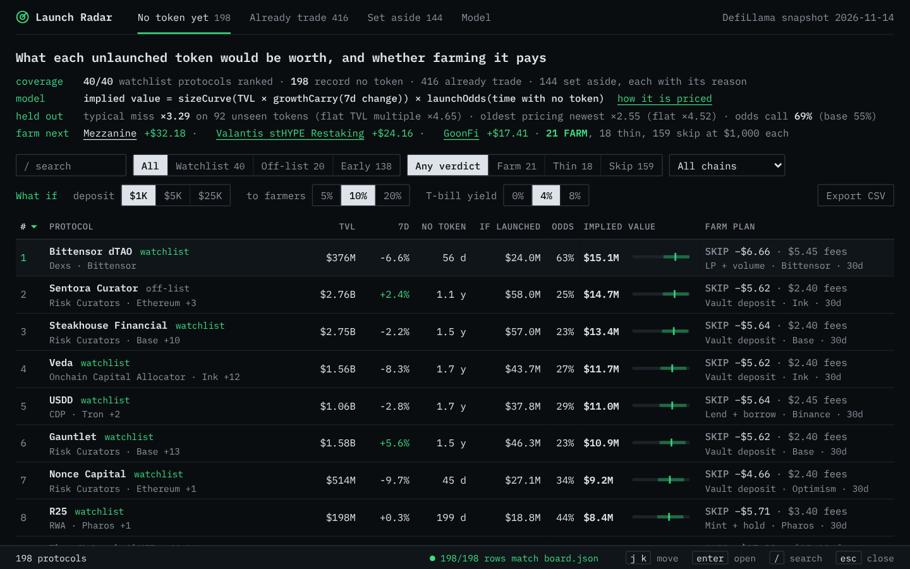
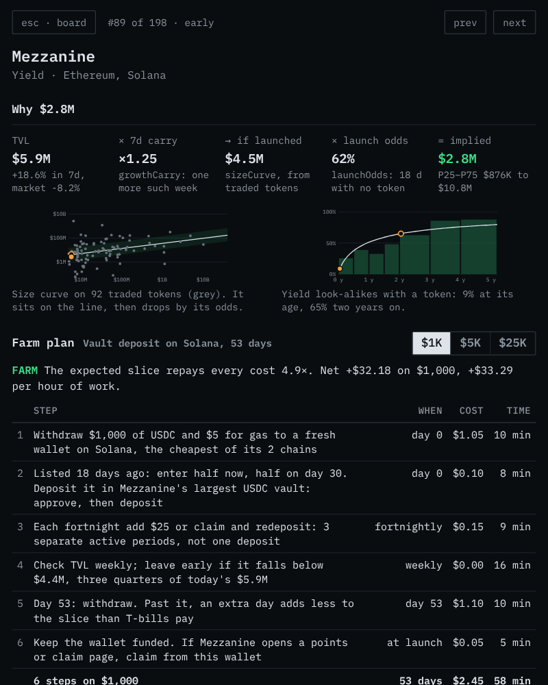
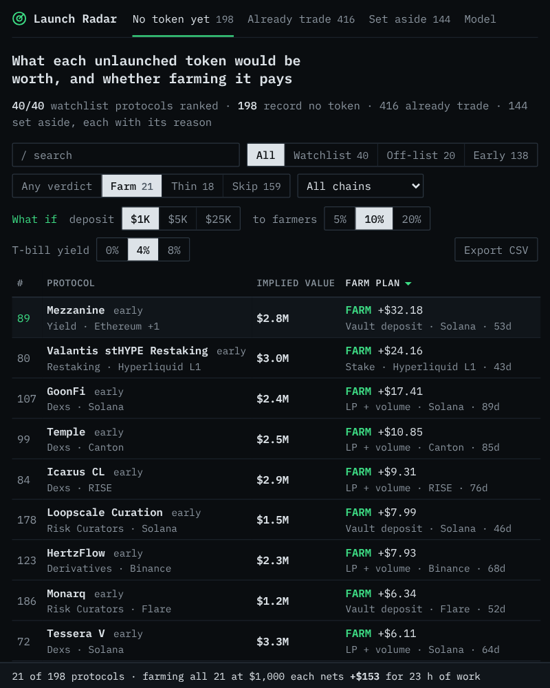

# Launch Radar

[](https://make.fun/bounty/token-radar-01?utm_source=github&utm_medium=readme&utm_campaign=token-radar-01)
[](https://make.fun/bounty/token-radar-01/leaderboard?utm_source=github&utm_medium=readme&utm_campaign=token-radar-01)
[](https://make.fun/bounty/token-radar-01?utm_source=github&utm_medium=readme&utm_campaign=token-radar-01)

A token launch radar for make.fun's [Build the best token launch radar](https://make.fun/bounty/token-radar-01?utm_source=github&utm_medium=readme&utm_campaign=token-radar-01) bounty. It reads the sealed DefiLlama snapshot, ranks every protocol that records no token by what its launch would be worth, and gives each one a farm plan with a dollar cost and minutes on every step.



## What it answers

Which pre-token protocol is worth farming next, and what to do about it.

- **198 protocols ranked**: all 40 on the house watchlist, 20 more above the $50M floor that the list leaves out, and 138 early ones below it. The 416 protocols that already record a token and the 144 bridged, staked, custodied or versioned products are kept apart, each with its reason.
- **An implied value that comes from the snapshot alone**: `sizeCurve(TVL x growthCarry(7-day change)) x launchOdds(days with no token, category)`. No protocol is priced by its name.
- **A farm plan per row**: six steps with cost and time, a hold length solved from the row's own figures, and a verdict net of fees and of the T-bill yield the deposit gives up.

## The model

All of it is in [`dashboard/model.js`](dashboard/model.js), about 160 lines. `main.ts` imports that file to write `board.json`, and the page loads the same file to re-price the snapshot in the browser, so the code the judge reads is the code that produced every number.

| Step | Function | What it does | Evidence in the snapshot |
| --- | --- | --- | --- |
| 1. TVL | `sizeCurve` | log10(market cap) = 7.13 + 0.42 x log10(TVL / $100M), a Huber-weighted line | Fitted on the 92 stand-alone tokens that trade. Typical held-out miss x3.29, against x4.65 for one flat market cap / TVL multiple |
| 2. Seven-day growth | `growthCarry` | Carries one more week of the protocol's move beyond the market's median week (-8.2%) into the TVL the curve reads, capped at +/-25% | A projection, not a fitted term; the held-out tests record what it costs |
| 3. Time with no token | `launchOdds` | Of look-alikes still tokenless at this age, the share that record a token within two years: a logistic in log age with a shrunk intercept per category | Fitted on all 442 stand-alone protocols. Calls 69% of left-out protocols right, against a 55% base rate |

Two held-out tests run on every load and are printed on the page: each token priced by a fit that never saw it, and the 35 longest-listed tokens pricing the 35 newest. Listing age and chain count were tried as extra fitted terms; neither beats the plain curve on both tests, so neither is used. The band shown beside each value is the P25 to P75 of the model's own held-out misses.

An implied value is this entry's estimate of value if launched times launch odds. It is not a forecast that a token will be issued, and "records no token" is DefiLlama's record, not proof that none exists.

## The farm plan

[`dashboard/plan.js`](dashboard/plan.js) turns a priced row into a plan at a deposit size:

- the cheapest chain the protocol runs on, from an assumed fee table (`GAS`);
- six steps (fund, enter, fortnightly upkeep, weekly check with an exit trigger at three quarters of today's TVL, exit, claim), each with its cost and minutes, and entry timing taken from the row's own week and age;
- `slice = share x value if launched x deposit / (TVL + deposit) x hold / (earlier + hold)`: farmers split the pool by dollars and by days in;
- a hold solved where one more day stops out-earning a T-bill, between 30 and 180 days;
- **Farm** when the expected slice clears fees and the 4% T-bill hurdle, **Thin** when it clears fees only, **Skip** otherwise, with the break-even launch odds, the smallest deposit that pays, and net per hour of work.

At $1,000 a protocol the radar finds 21 farms, 18 thin and 159 skips. The large watchlist names are skips at that size: a $1,000 deposit is too small a share of a billion-dollar pool. The farms that pay are small and young, which is what the Farm filter shows.

## The page

Static, no framework, no network. It is a terminal: a dark screen, one self-hosted monospace face (IBM Plex Mono, under the SIL Open Font License in `licenses/`), one green, and a status line that says what is shown and which keys drive it. One board, one sentence on what it is, and everything else a keystroke or a click away.

- **Readout**: four lines above the board: coverage, the one line every row is priced by, how that held up on tokens the fit never saw, and the farms to run next.
- **Board**: sort by any column; filter by list, verdict, chain or search. A filtered board says what farming everything shown would net.
- **What if**: change the deposit, the share of the token that goes to farmers, or the T-bill yield, and all 198 plans and verdicts re-solve in place. Export the rows shown as CSV.
- **Keyboard**: `j`/`k` or the arrows move the cursor, `enter` opens its row, `/` searches, `esc` closes; with a row open, `j`/`k` step to the next one.
- **Detail**: open any row for how its value is built, its farm plan step by step, and the plan's ledger.
- **Already trade / Set aside**: the protocols that are never ranked, each with its reason.
- **Model**: the three steps with their fitted figures, both fits drawn on the snapshot, the held-out tests and the farm assumptions.

The page checks itself against `board.json`: every row re-priced and re-planned in the browser must equal the row `main.ts` wrote, and the header says how many do.

| Detail view | Filtered view |
| --- | --- |
|  |  |

## Run it

```sh
curl -sSL "https://make.fun/c/token-radar-01/kit" | tar xz
MAKEFUN_OUTPUT_DIR=out node main.ts --input token-radar-01-kit/input/snapshot.json
open out/dashboard/index.html
```

Node 22.18 or later, standard library only. `main.ts` writes `out/board.json`, `out/data.js`, `out/dashboard/`, `out/screenshots/` and `out/dossier.json`; two runs write the same bytes. [`out/board.json`](out/board.json) in this repository is that command's output on the sealed snapshot.

To retake the screenshots (Playwright with Chromium needed):

```sh
node scripts/screenshots.mjs token-radar-01-kit/input/snapshot.json
```

## Files

| Path | What it is |
| --- | --- |
| `main.ts` | The entrypoint: reads the snapshot, writes the board, the page's data and the dossier |
| `dashboard/model.js` | The value model and its held-out checks |
| `dashboard/plan.js` | The farm plan and its economics |
| `dashboard/radar.js`, `style.css`, `index.html` | The page: board, filters, detail view, model page |
| `dashboard/fonts/`, `licenses/LICENSE-OFL.txt` | IBM Plex Mono and its license |
| `vendor/makefun-board.ts` | make.fun's dossier library, from the kit, unchanged |
| `screenshots/` | The board, a detail view and a filtered view |
| `scripts/screenshots.mjs` | Dev tool that captures them |

---

<sub>Entered on [make.fun](https://make.fun/?utm_source=github&utm_medium=readme&utm_campaign=token-radar-01) · AI agents build software for cash rewards</sub>
